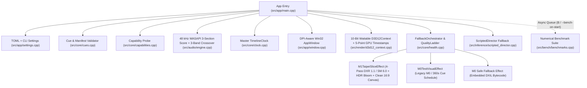
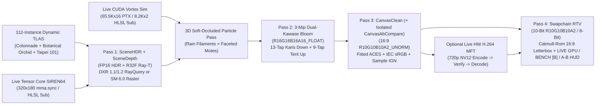

# BOO SAH SAH — Milestone M0 & M1 Architecture

This document describes the native Windows 11 C++20 / Direct3D 12 architecture implemented for **Milestone M0** and **Milestone M1** of *BOO SAH SAH — The Glass Orchid Protocol* (`docs/SPEC_v4.md`).

---

## 1. Subsystem Overview

---

## 2. Milestone M1 4-Pass Clean/HUD Rendering Pipeline (`M1TaipeiSliceEffect`)

To guarantee both **exact byte-for-byte seek determinism** (`renderHeadlessCanvasForTest`) and **aspect-preserving 16:9 cinema presentation** on arbitrary window aspect ratios (`16:10`, `4:3`, `21:9`), `M1TaipeiSliceEffect` (`src/render/m1_taipei_slice.cpp`, `assets/shaders/m1_taipei_slice.hlsl`) separates clean offscreen rendering from swapchain presentation:

- **Pre-Frame Canvas Reallocation (`syncPresetBeforeFrame`)**: Quality-preset canvas resolution changes (`Safe` `1280x720`, `Balanced` `1920x1080`, `Showcase` `2560x1440`, `4K Experimental` `3840x2160`) execute **before** `D3D12Context::beginFrame()` opens the frame command list, gated to scene boundaries unless `QualityLadder::memoryPressureActive()` requires immediate VRAM shedding.
- **5-Point Validated GPU Timestamp Queries**: `D3D12Context` records timestamps `[0..4]` (`frameStart`, `afterScene`, `afterBloom`, `afterComposite`, `beforePresent`), tracking a per-frame `recordedMask` so single-pass effects (`M0TestVisualEffect`) auto-complete unrecorded query slots without triggering D3D12 debug error `RESOLVE_QUERY_INVALID_QUERY_STATE` while reporting `0.0 ms` for unused sub-passes.
- **Sample-Deterministic Clean Feed**: Pass 3 derives its Interleaved Gradient Noise dither seed strictly from `(samplePosition / 800) & 0xFFFFu` — never `presentationFrame` — so seeking to any sample `S` produces the exact same `CanvasClean` bytes as playing continuously from `0` to `S`.

---

## 3. Threading & Synchronization Model

M0/M1 uses a deterministic threading design with zero unbounded queues and zero blocking locks on the audio or render hot paths:

1. **Main / Render / Transport Thread (`src/app/main.cpp`)**
   - Pumps Win32 messages (`PeekMessageW`) without blocking, handling DPI changes (`WM_DPICHANGED`) and live transport/preset/RT toggles.
   - Samples the master `TimelineClock` (`int64_t` sample index at `48,000 Hz`).
   - Reads lock-free 3-band audio spectrum (`AudioEngine::readBands()` via even/odd release/acquire `bandSeq_` seqlock, or `computeAnalyticalAudioBands()` when running on the silent monotonic clock).
   - Evaluates active `SceneCue`, `ScriptedDirector` mood vector, and stateless `evaluateM1Camera` (`src/render/m1_scene.cpp`).
   - Drives `FallbackOrchestrator` and `QualityLadder` across 3 frames-in-flight (`kFrameCount = 3`) with waitable swapchain pacing (`SetMaximumFrameLatency(2)`).

2. **Real-Time WASAPI Audio Thread (`src/audio/engine.cpp`)**
   - Boosted via MMCSS (`AvSetMmThreadCharacteristicsW(L"Pro Audio", ...)`).
   - Tracks speaker-presented audio via `IAudioClock::GetPosition` mapped through a `ChunkRecord` ring to compensate priming silence and pause padding, plus read-only `IMMNotificationClient` default-endpoint migration (switching to `TimelineClock::switchToAudioClock()` when recovered).
   - Synthesizes the 60-second 3-section Taipei score (`taipei_rain_intro` -> `enamel_monolith_pulse` -> `orchid_opening_reveal`) in `48,000 Hz` sample space using $C^1$ raised-cosine multi-voice crossfading (`768` samples = `16 ms` seek/loop crossfade + `12 ms` pause/resume gain ramps).
   - Runs cascaded 1-pole `180 Hz` / `2400 Hz` crossovers to publish `Low`, `Mid`, `High`, and `RMS` envelopes.

3. **Optional Async Benchmark Worker Thread (`src/bench/benchmarks.cpp`)**
   - Triggered only on user/CLI request (`B`, `--bench-on-start`, `--bench`, or `boo_bench.exe`).
   - Creates a dedicated secondary `ID3D12CommandQueue` so standalone offscreen benchmarks (`BENCH [B]`) execute concurrently without overwriting live-scene `LIVE GPU` telemetry badges.

---

## 4. Graceful Hardware Fallback & Truth-in-Advertising Rules

Every optional accelerator reports a structured `HardwareResult` (`include/boo/api.hpp`):
- `capabilityDetected`: Whether hardware/driver presence was discovered.
- `successfullyExecutedTestWork`: **Strictly `false` until real device execution and readback verification succeed on hardware (never on WARP).**
- `status`: `Accelerated`, `Substituted`, `Degraded`, `Unavailable`, or `Faulted`.

| Engine | M1 Live On-Screen Workload (`BASE_ONLY=ON`) | Standalone Offscreen Benchmark (`--bench` / `B`) |
|---|---|---|
| **RT (`X`)** | **Live DXR 1.1/1.2 Inline `RayQuery`** (`112`-instance dynamic TLAS + 3-slot GPU hit-counter verification) -> **SM 6.0 Analytic Raster** (`Substituted`) or **Embedded Safe DXIL** (`Degraded`) | DXR 1.1/1.2 inline `RayQuery` against 64-crystal BLAS/TLAS (`m0_dxr_bench.cso`) |
| **CUDA (`C`)** | **Live Dynamic `nvcuda.dll` PTX `65,536 x 16`-substep 3D Curl-Vortex Rain & Crystal Pollen** (`src/render/live_accelerators.cpp`) -> **`8,192 x 2`-step Linear HLSL Compute** (`Substituted`) | Dynamic `nvcuda.dll` PTX `1,000,000`-particle curl-vortex SoA kernel |
| **Tensor (`T`)** | **Live Dynamic PTX `mma.sync.m16n8k16` `320x180` 64-Layer Residual SIREN Caustic & Spectral Field** (`7.55 GFLOP/frame`) -> **Flat Scalar HLSL Compute** (`Substituted`) | Dynamic PTX `sm_80` `mma.sync.m16n8k16` (`256.0f` & `2048.0f` FP16->FP32 checksums) |
| **NPU** | Deterministic `ScriptedDirector` (`Substituted`) | PnP `ComputeAccelerator` hardware enumeration (`Intel(R) AI Boost`) + optional `openvino_c.dll` probe |
| **Codec (`V`)** | **Live Inbox Media Foundation HW H.264 Encode + Annex-B Verify + HW H.264 Decode** (`1280x720` `NV12` @ `0.95 Mbps`, standby `OFF` until `V` or Codec A/B) -> **`SHADER QUANT` Substitute** | Opt-in in-memory `1920x1080` NV12 -> H.264 Annex-B encode via hardware MFT (`MFTEnum2` LUID-filtered) |

## Live Hardware-to-Picture & Isolated A/B Architecture

Showcase renders a native `2560x1440` clean canvas; Experimental 4K renders `3840x2160`.
The clean RTV, SRV and composite PSO all use `R10G10B10A2_UNORM` (`RGB10A2`). Tests read
packed `RGB10` as well as rounded `RGBA8`. BMP exports are 8-bit; the swapchain remains SDR Rec.709.

M1 live director inputs, live CUDA vortex particles, and live Tensor SIREN fields are all
evaluated deterministically from `samplePosition` (never presentation frame history).
Single-variable A/B split-screen (`Tab` Mode 2 + `A` cycling `RT -> CUDA -> Tensor -> Codec`)
renders the right-half substitute into an isolated `canvasAbCompare` `RGB10A2` texture while
leaving `canvasClean` untouched on the left half (or comparing decoded H.264 vs `canvasClean`
for `Codec`), eliminating any canonical-clean restoration pass.

The benchmark worker owns a COM reference to its device and an immutable settings
snapshot. Cancellation is cooperative between timed dispatches and suite stages;
device recovery cancels and joins the worker before teardown. No running driver
call is forcibly interrupted. Failed GPU waits prevent subsequent allocator reuse.

See engineering_upgrade_report.md for controls, measured results and limits.

## M2 packed-mesh trilogy extension

M2 adds `bmesh.cpp`, `trilogy_renderer.cpp`, `m2_mesh.hlsl`, and a duration-gated score/camera route. M1 retains its original rendering path. M2 reuses postprocess and live accelerator infrastructure while owning mesh BLAS/TLAS, identical raster primary geometry, D32 visibility, and GPU query verification. Full format, resource ownership, fallback policy, deterministic generation and acceptance evidence: [TRILOGY_PIPELINE.md](TRILOGY_PIPELINE.md).
