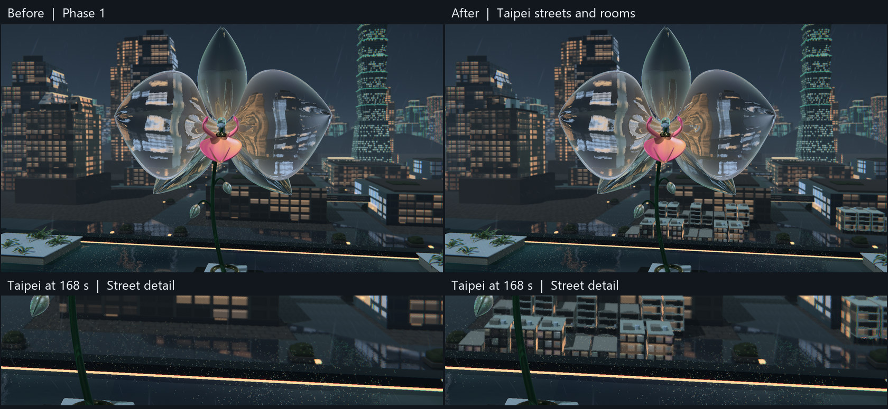

# Taipei in motion

The camera pulls back from the glass orchid over ten seconds of the Taipei trilogy. At 2:48, look just to the right of the stem. Ceramic walk-ups, roof equipment and arcades fill the block between the garden and the towers. Their silhouettes move against the older skyline as the camera rises. By 2:56, the shot favors the orchid and Taipei 101, and the street detail occupies a smaller part of the frame.

[Watch the synchronized comparison, before left and after right](taipei-comparison.mp4) · [Full-size before](taipei-before.mp4) · [Full-size after](taipei-after.mp4)



The before renderer is Phase 1 `f5dbac0`. The after renderer is Phase 3 `71f3e46`. Both use the public trilogy cue, its authored camera, the Family edition, the Showcase preset and the same sample-driven director. No camera override, HUD, subtitles or soundtrack is present in the captures. The static architecture comparison and close-window implementation are in [PR 7](https://github.com/jbrick2070/boo-sah-sah/pull/7) and [PR 8](https://github.com/jbrick2070/boo-sah-sah/pull/8).

Each take contains 300 native 2560 × 1440 frames at 30 fps. Frame 0 is sample 8,064,000 (168.000 s), frame 240 is sample 8,448,000 (176.000 s), and frame 299 is sample 8,542,400 (177.967 s). The exclusive endpoint is sample 8,544,000. The capture writes the original packed 10-bit canvas words to disk. The MP4 review copies use browser-compatible 8-bit H.264. Each panel in the side-by-side copy scales the entire frame to 1280 × 720. [Native frame checkpoints](capture-takes.json)

## GPU measurements

Each timing window starts at the indicated sample and contains 60 frames after 24 warm-up frames. Times cover the Direct3D 12 graphics queue through its final presentation draw. All measurements below used the RTX 5080 Laptop GPU and the public 2560 × 1440 Showcase preset.

| Trilogy time | Before GPU p50 / p95 | After GPU p50 / p95 | After near / middle / far placements |
| --- | ---: | ---: | ---: |
| 2:48 | 5.94 / 5.98 ms | 6.06 / 6.32 ms | 1 / 22 / 353 |
| 2:56 | 4.25 / 5.49 ms | 4.58 / 4.95 ms | 1 / 11 / 374 |

At both anchors, each take matches the native 10-bit hash of its independent fixed-shot capture. Both after shots verified live hardware ray work and stayed within the 12 ms GPU p95 target. Peak process-local video memory during those windows was 1,414 MiB. Forced raster reported zero ray instances and GPU p95 of 1.47 ms at 2:48 and 1.32 ms at 2:56. The two separate close-window views reached 1.40 ms head-on and 1.56 ms at an oblique angle. The physical 8 GB RTX 4060 test is pending. [Anchor telemetry and fallback receipts](anchor-measurements.json)

## Reproduce

Use separate worktrees and launch each executable from its own source tree so it reads the matching assets. The capture harness is the only change needed for Phase 1. This command applies just that test change in the Phase 1 worktree.

```powershell
git diff origin/codex/city-room-interiors...origin/codex/taipei-slice-review -- tests/integration/film_capture_gate.hpp tests/integration/integration_main.cpp | git apply -C1
```

Build each worktree in Release and run the fixed capture. Use a separate capture directory for each version. Allow 4,423,680,000 bytes per raw take.

```powershell
.\scripts\build.ps1
.\build\x64-release\boo_integration_tests.exe --taipei-slice-video --no-activate --capture-dir D:\captures\after
```

The encoder requires FFmpeg and FFprobe on PATH. It validates both capture receipts, verifies adapter equality, and checks the dimensions, decoded frame count, frame rate and duration of each MP4.

```powershell
python tools\encode_taipei_slice.py D:\captures\before\trilogy_taipei_168s_178s D:\captures\after\trilogy_taipei_168s_178s D:\captures\review
```
