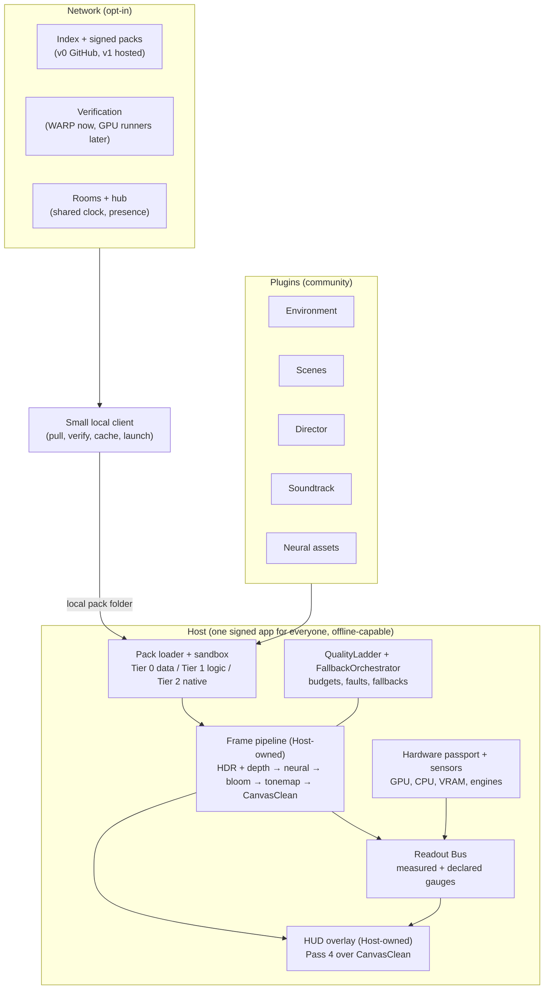
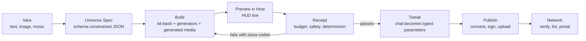

# Community Universe Framework

Draft v0.1, 2026-11-20. Working title: **Orchid Commons** (rename freely).

> **Status, 2026-11-21:** the network and multi-world design has moved to the Demo-Verse repository (see [community_platform_implementation_plan.md](community_platform_implementation_plan.md)), where Orchid Commons is the name of Boo Sah Sah's founding world. Keep this draft for its readout, Store and safety analysis. Where it disagrees with Demo-Verse, Demo-Verse wins.

Tags used below: **[exists]** I read it in this repo. **[refactor]** it exists but is not shaped for this yet. **[new]** it does not exist. Anything without a tag is a proposal.

## 0. What this is

Boo Sah Sah already does something most demos do not: every effect is labelled honestly (Accelerated, Substituted, Degraded, Unavailable, Faulted) and measured live on a GPU and CPU readout. This framework turns that habit into a platform. People use AI to make their own **universes** (environments plus scenes), publish them to a shared **network**, and every universe runs inside the same **Host**, under the same **readout HUD**, and produces the same **receipt**.

The nearest relatives are Second Life (build your own world), VRChat and Roblox (sandboxed user content with performance rules), 3DMark (the numbers are the point) and the demoscene (compos, size classes). What is different here is that the hardware readout is not a debug overlay. It is the platform's contract.

### How I read your notes

- *"conglomerate universe, PC/VR platform of demos"* means one platform and network holding many universes. PC first, VR later (section 8).
- *"same GPU/CPU readout stats architecture"* means one HUD, one set of honesty labels and one receipt format for every universe (section 4).
- *"environment and scenes as a standard package layout, or each its own plugin drafted onto the HUD framework"* means both. The package layout **is** the plugin, and its manifest declares what attaches to the HUD (sections 3 and 4).
- *"AI to quickly create your own universe and publish it to the network"* is sections 6 and 7.
- *"a generator tool of universes, not sure if Comfy can create these templates"* is section 6.7: ComfyUI can make the ingredients, and a planner plus the Studio API makes the structure.
- *"small local client pulling from GitHub"* is network v0 (sections 7.2 and 7.3). I read *"IOS?"* as "should it also exist on iOS" and answer that in 7.3. If you meant "yes?", the answer is yes.

### What this draft assumes

1. One Host, many plugins. The HUD and readout belong to the Host. Today they live inside the effect (4.4).
2. Two standard package types: **Environment** (the space) and **Scene** (a time-bounded beat in it). A **Universe** bundles them. Each ships as a plugin.
3. Three trust tiers: data only, sandboxed logic, native. The Store build only ever runs the first two.
4. AI is both the author (prompt to published universe, with a QA loop) and a runtime service (neural shading, the director).
5. The network starts as a GitHub-hosted index plus a small local client. Rooms, a hub and the MMO part come later, on top of signed, content-addressed packs.
6. The Store Host stays offline-capable. Anything networked is opt-in and lives in the small client (7.7).

## 1. Principles

1. **The readout is the constant; everything else is a plugin.** One HUD, one set of honesty labels, one receipt for every universe.
2. **Plugins cannot self-certify.** A plugin never marks itself Accelerated. The Host measures and verifies, using the rule the code already follows: `capabilityDetected` is not `successfullyExecutedTestWork`. Numbers a plugin reports about itself are shown, but badged Declared.
3. **Data first, code last.** Most universes are data (Tier 0). Some add sandboxed logic (Tier 1). Native code (Tier 2) is for first-party work and developer mode.
4. **Deterministic from the sample clock.** A frame is a function of (pack hash, seed, sample position), as in today's film. That gives seeking, golden captures, CI verification and cheap shared playback.
5. **Everything degrades gracefully.** Every scene names a preferred engine and a fallback visual, every mesh has a deterministic procedural fallback, and the quality ladder sheds load.
6. **AI is an author and a runtime service, behind the same gates.** AI-made content passes the same validators and shows the same readout as hand-made content.
7. **Render locally, keep the network thin.** Your GPU renders. Servers only distribute, verify and introduce people.
8. **Offline-first stays true until the user opts in.** The shipped Host has no network code today (7.7). Keep it that way.

## 2. Architecture



**The frame contract.** A scene plugin renders `SceneHDR` (FP16) and `SceneDepth` (R32F), plus motion vectors, jitter and camera when it wants DLSS or frame generation. The Host does the rest: neural services, bloom, tonemap, `CanvasClean`, HUD, swapchain. A plugin that outputs HDR and depth inherits neural shading, upscaling, frame generation, capture, the clean Spout feed and the HUD for free. **[refactor]** Today those passes live inside `M1TaipeiSliceEffect` (`src/render/m1_taipei_slice.cpp`).

## 3. The standard package layout

**What exists today.** Boo Sah Sah already has a scene *timeline* and a shared *engine*. Cue sheets (`assets/cues/*.json`) list `SceneCue` entries with sample-exact timing, seed, preferred engine, fallback visual, audio section and director permission, validated against the asset manifest. The film's scenes share one renderer, one mesh format, one post and HUD pass, the live engines, the director and the audio clock. What does not exist is a scene *format*. Each scene's content (camera paths, actor motion, lighting, special effects) is written in C++ (`src/render/m1_scene.cpp`, `src/render/city_modules.cpp`, film-time checks in `src/app/main.cpp`) and HLSL (`assets/shaders/m1_taipei_slice.hlsl`, `assets/shaders/m2_mesh.hlsl`), with meshes made by the Python and Blender generators in `tools/`. The cue's `visual` id selects those code paths; it does not load a package. The layout below keeps the timeline and the engine and moves the content into data.

### 3.1 Vocabulary

| Term | Meaning |
|---|---|
| **Universe** | The unit people create and publish. Holds at least one Environment and one Scene. Playable as a **Show** (linear, like the film today), as **Explore** (free camera, like Explore Studio today), or both. |
| **Environment** | A persistent space: what exists and how it looks and behaves, independent of story time. Kits (meshes), materials, sky and light rig, ambience, actors with motion functions, zones (camera-safe areas, portals), LOD rules. |
| **Scene** | A time-bounded beat inside an Environment: camera rig, timing, seed, preferred engine and fallback visual, director policy, captions. This is today's `SceneCue`. |
| **Plugin** | Anything the Host loads from a pack. Kinds: environment, scene, director, soundtrack, neural. |
| **Pack** | The signed, content-addressed archive a plugin or universe ships in. |
| **Template** | A pack with `template: true`, typed `slots` and named `media_slots`. A person, the AI or the generator fills the slots (6.7). Remix, prompt and compose are all "fill the slots". |
| **Recipe** | A named, versioned procedure that turns typed inputs into files of a known type inside a budget, such as `comfy:text-to-panorama` or `gen:pbr-tile` (6.7). |
| **Hardware passport** | A sanitized snapshot of `SystemCapabilities`: what this machine can do, with identifiers removed. |

### 3.2 Layout

```
my-universe/
├── universe.json          identity, version, host ABI, license, rating, AI disclosure
├── budget.json            declared budgets per quality preset, engines wanted
├── readout.json           gauges this pack adds to the HUD (Declared rows)
├── environments/<env-id>/
│   ├── environment.json   kits, materials, sky and light rig, ambience, actors, zones, portals, LOD
│   ├── kits/*.bmesh       BMESH001 packed meshes (today's format)
│   ├── textures/*.btex    today's texture format
│   ├── shaders/*.hlsl     Tier 1: fragments for fixed slots only (sky, material, particle step, post)
│   └── logic/             Tier 1: curve and expression files for actor motion, f(t, seed, params)
├── scenes/<scene-id>/
│   ├── scene.json         environment ref, camera rig, SceneCue fields, director policy, captions
│   └── cues.json          optional sub-timeline, same schema as assets/cues/*.json
├── director/              optional: curves, or an OpenVINO IR (16 floats in, 5 controls out)
├── audio/                 score or stems, plus 3-band analyzer metadata
├── neural/                per-pack networks (texture latents, shading MLP) and training provenance
├── strings/<locale>.json  same catalog format as assets/strings
├── credits.json           AssetManifestEntry list: id, path, kind, provenance, license, sha256
├── tests/                 golden captures and seek samples: the pack's own acceptance gate
├── native/                Tier 2 only: DLL plus C ABI manifest (never in the Store channel)
└── receipts/              Host-written run receipts, never hand-edited
```

### 3.3 Where each part lives today

| Part | In the pack | Today in this repo |
|---|---|---|
| Identity, version, license, AI disclosure | `universe.json` | Spread across the `assets/manifest.json` header, `LICENSE-ASSETS.md`, `VERSION` |
| Asset credits and hashes | `credits.json` | `assets/manifest.json`: `id`, `path`, `kind`, `provenance`, `license`, `sha256` **[exists]** |
| Scene timeline | `scenes/*/scene.json`, `cues.json` | `assets/cues/*.json`, schema 1 **[exists]**. The `visual` string selects hard-coded code through `ShowVisualMode` in `src/app/main.cpp` and `m1_`/`m2_` prefix checks in `src/core/cues.cpp` **[refactor]** |
| Geometry | `kits/*.bmesh` | `assets/meshes/*.bmesh` **[exists]**. The kit list is written in code inside `TrilogyMeshRenderer` (`src/render/trilogy_renderer.cpp`) **[refactor]** |
| Textures | `textures/*.btex` | `assets/textures/*.btex` **[exists]** |
| Actor motion | `logic/` | C++ functions in `include/boo/city_modules.hpp` such as `shanghaiPolicePose`, `relayFlyby`, `cityLiftTravel` **[refactor]** |
| Director | `director/` | `ScriptedDirector`, `OpenVinoDirector`, model at `assets/models/madame_n_director.xml` **[exists]** |
| Neural assets | `neural/` | `assets/neural/neural_networks.bin`, trained by `tools/train_neural_weights.py`. One set for the whole film **[exists]** |
| Strings | `strings/` | `assets/strings/*.json`: 24 translated catalogs plus English **[exists]** |
| Budgets | `budget.json` | `config/quality_presets.json` and `QualityLadder`, global to the app **[exists]** |
| HUD gauges | `readout.json` | `HudTelemetrySnapshot`, a closed struct **[refactor]** |
| Tests | `tests/` | `--film-captures`, `--film-stress`, `--validate-cues`, film-only **[exists]** |

### 3.4 Manifest sketches

```jsonc
// universe.json
{
  "schema": 1,
  "id": "example.glass-orchid",            // publisher.slug, the namespace plugins live in
  "title": "Glass Orchid Protocol",
  "version": "1.2.0",
  "host_abi": "1.x",
  "environments": ["taipei-basin", "enamel-cathedral"],
  "scenes": ["taipei_intro", "mirror_intelligence"],
  "modes": ["show", "explore"],
  "tier": 1,                                // highest tier any part needs: 0 data, 1 logic, 2 native
  "license": { "code": "MIT", "assets": "CC-BY-NC-4.0" },
  "rating": "everyone",
  "ai": { "assisted": true, "disclosure": "meshes procedural, textures diffusion" },
  "requires": { "d3d12": "FL12_1", "optional": ["dxr1.1", "tensor", "npu"] }
}
```

```jsonc
// environment.json
{
  "schema": 1,
  "id": "taipei-basin",
  "kits": [{ "id": "hero", "mesh": "kits/taipei_101_hero.bmesh", "fallback": "procedural:tower-kit" }],
  "light_rig": { "sun": { "elevation": 0.52, "azimuth": 0.42 }, "lamps": ["sconce", "halo"], "sky": "dusk-basin" },
  "ambience": "audio/rain-bed.flac",
  "actors": [{ "id": "kite-flock", "motion": "logic/flock.curves" }],
  "zones": [
    { "id": "terrace", "camera_safe": true },
    { "id": "gate-a", "portal": "orchid://u/<id>" }
  ],
  "lod": { "near": "authored", "mid": "module", "far": "module-low" }
}
```

```jsonc
// scene.json: a superset of today's cue-sheet scene entry
{
  "id": "mirror_intelligence",
  "environment": "taipei-basin",                       // new
  "camera": "rigs/mirror.json",                        // new
  "start_sample": 2160000, "end_sample": 4800000,
  "visual": "example.glass-orchid:mirror_orchid",      // namespaced id, resolved by the plugin registry
  "fallback_visual": "example.glass-orchid:mirror_probes",
  "preferred_engine": "RT",
  "audio_section": "crystal_percussion_pulses",
  "director": { "allow_modulation": true, "bounds": { "bloom": [0.2, 0.7] } },
  "captions": "strings/captions.json"
}
```

`visual` stops being a magic string matched by prefix checks and a `ShowVisualMode` switch. It becomes an id the plugin registry resolves. `assets/manifest.json` already keeps a `visualPresets` list that cue sheets are validated against (`validateCueSheetAgainstManifest`), so the registry idea is half built **[exists]**.

```jsonc
// budget.json: what the pack promises. The Host measures it and compares. Values illustrative.
{
  "schema": 1,
  "presets": {
    "safe":     { "gpu_ms_p95": 10.0, "vram_mb": 2048 },
    "balanced": { "gpu_ms_p95": 14.0, "vram_mb": 4096 },
    "showcase": { "gpu_ms_p95": 16.0, "vram_mb": 8192 }
  },
  "engines": { "rt": "preferred", "tensor": "optional", "cuda": "none", "npu": "optional", "codec": "none" },
  "neural": { "gflop_per_frame_max": 12.0 }
}
```

```jsonc
// readout.json: gauges that attach to the HUD
{
  "schema": 1,
  "group": "Glass Orchid",
  "gauges": [
    { "id": "flock",  "labelKey": "g.flock",  "unit": "",   "min": 0,   "max": 64 },
    { "id": "relay",  "labelKey": "g.relay",  "unit": "dB", "min": -60, "max": 0, "warn": -48 }
  ]
}
```

## 4. Attaching to the HUD: the Readout Bus

### 4.1 Measured by the Host for every plugin (no plugin code involved)

- **GPU ms per plugin scope.** **[refactor]** `D3D12Context` records five fixed timestamp points per frame. It needs a per-scope query ring.
- **CPU ms per plugin callback.**
- **VRAM attributed to the plugin.** Plugins allocate GPU resources only through the Host, so the Host can account for them. `queryEstimatedAppVramBytes()` is global today.
- **Engine status, verified by the Host.** **[exists]** RT is verified by GPU hit-counter readback, CUDA and Tensor by output checks, NPU by real inference results (`HardwareResult`, `LivePillarTelemetry::hardwareVerified`).
- **Reliability.** Quality downgrades, effect faults, cooldowns, device recoveries, present stalls.

### 4.2 Declared by plugins

Up to a fixed number of gauges per plugin (label, unit, range, warn threshold), pushed once per frame and drawn in the plugin's own group. They are badged Declared so the HUD never blurs the line between measured and claimed. Labels are catalog keys so they localize.

### 4.3 Data model **[new]**

```cpp
// Generalises LivePillarTelemetry and the HUD's recentGpuMs[16].
struct Gauge {
    uint32_t id;              // stable per plugin
    uint32_t group;           // 0 = Host core, 1.. = plugin groups
    const char* labelKey;     // catalog key, so it localizes
    const char* unit;
    float value, min, max, warn;
    enum class Source : uint8_t { Measured, Declared } source;
    BackendStatus status;     // existing enum: Accelerated .. Faulted
    bool verified;            // Host-verified execution, same meaning as today
    float history[16];        // the ring the HUD sparkline already draws
};
```

`LivePillarTelemetry` (status, activeInScene, hardwareVerified, workloadItems, workloadSteps, executionMs, throughput, quality, aux) is already a generic gauge record. It is limited to four fixed pillars.

### 4.4 What has to change in the HUD

1. **Pull the HUD out of the effect.** Today `IEffect::setHudTelemetry` is implemented by both `M0TestVisualEffect` and `M1TaipeiSliceEffect`, and `FallbackOrchestrator::setHudTelemetry` pushes the packet to both. The HUD drawing is in `assets/shaders/m1_taipei_slice.hlsl` (267 lines mention it; `m0_test_visual.hlsl` has 2, and `m2_mesh.hlsl` has none because the trilogy path reuses the M1 effect's pass 4). The seam already exists: Pass 3 `CanvasClean` is HUD-free (it is what Spout publishes) and Pass 4 composes the HUD. Make Pass 4 a Host-owned `HudOverlay` that draws over any plugin's `CanvasClean`.
2. **Open the data.** `HudTelemetrySnapshot` is a closed struct. Keep it as the Host's core group and add a registry for plugin gauges beside it.
3. **Open the labels.** `UiLabel` is a compile-time enum shared with the shader (`UI_LBL_*`), and its 71 labels fill 71 of the 72 cells in the 4 by 18 label atlas (`UiTextAtlasLayout`). Plugin strings need a dynamic path. `UiTextLayer` already renders arbitrary caption text through DirectWrite into its own atlas band, so a plugin-label band follows an existing pattern.
4. **Per-scope GPU timestamps** (4.1).
5. **HUD modes.** Plugin groups must behave in all four modes (`Tab`/`F1`: Full Telemetry, Compact Strip, A/B Split, Clean Cinema) and in the dashboard's full, mini and hidden states. Compact shows only the top measured row of each group. The clean feed never carries the HUD in any mode.

### 4.5 The receipt

The receipt is the HUD's data written to disk. **[exists]** as `exportDiagnosticsJson`, `exportBenchmarkJson`, `exportBenchmarkCsv` and the `F12` capture with JSON timing. Additions: pack hash, seed, Host build, schema version, sanitized passport, optional signature.

```jsonc
// Illustrative values only.
{
  "schema": 1,
  "universe": "example.glass-orchid@1.2.0",
  "pack_sha256": "<hash>",
  "seed": 266203,
  "host": { "build": "1.1.6", "abi": "1.0" },
  "passport": { "gpu_class": "nvidia-rtx-laptop-16gb", "dxr": "1.1", "tensor": "ptx", "npu": "present", "warp": false },
  "run": { "preset": "showcase", "resolution": "2560x1440", "seconds": 360, "start_sample": 0 },
  "frame": { "gpu_ms": { "p50": 5.1, "p95": 6.4, "p99": 7.9 }, "cpu_ms": { "p50": 1.8, "p95": 2.6 }, "present_stalls": 0 },
  "sensors": { "peak_temp_c": 71, "avg_power_w": 118, "power_limited_samples": 0, "cpu_system_avg_pct": 14 },
  "engines": { "rt": "Accelerated, verified", "tensor": "Accelerated, verified", "npu": "Substituted", "cuda": "Accelerated, verified", "codec": "Unavailable" },
  "budget": { "declared_p95_ms": 16.0, "met": true },
  "faults": { "effect_faults": 0, "quality_downgrades": 0, "device_recoveries": 0 },
  "verified_by": "declared"
}
```

Rules: a receipt from the creator's machine is **Declared**. A receipt re-run by a runner we control is **Verified**. WARP runs are never ranked. `AdapterInfo` carries LUID, device id and subsystem id, so those are stripped and replaced by a hardware class before anything is shared.

## 5. Plugin tiers and safety

| Tier | What it is | Written by | Containment | Channel |
|---|---|---|---|---|
| 0 Data | JSON, `.bmesh`, `.btex`, audio, plus Host-provided blocks (kits, skies, camera rigs, particles, post looks) | anyone, and AI | cannot execute code; schema and budget validation | Store and sideload |
| 1 Logic | Tier 0 plus curve and expression files for motion, and HLSL fragments for fixed slots (sky, material, particle step, post) | creators | no I/O, no wall clock; CPU instruction budget; GPU scope budget with a watchdog; fragments compiled to DXIL and validated at publish time, so the Host never compiles untrusted text | Store (subject to certification), sideload |
| 2 Native | DLL with a versioned C ABI | first-party, partners, developers | full trust; signed, developer mode | sideload and GitHub only |

**Containment rules**

- Plugins supply kernels and parameters. **The Host chooses dispatch sizes, resolutions and counts**, inside the declared budget.
- A scope over its GPU budget for N frames in a row is disabled, the plugin is marked Faulted, enters Cooldown, and `FallbackOrchestrator` swaps in the scene's `fallback_visual`. **[exists]** for effects (`HealthState::Faulted`, `Cooldown`); extend to plugin scopes.
- Pre-screen on **WARP** in CI. `--force-warp` and `tests/integration/warp_playback.cmake` exist, so crashes, NaNs, non-determinism and runaway loops are caught without a GPU.
- Device-lost recovery exists (one teardown and recreate attempt, exercised by `--inject-device-lost`), but it is a last resort. A plugin that hangs a real GPU can still freeze the desktop until the driver's timeout (about 2 seconds by default), so static limits come first.
- Tier 1 motion is a **curve and expression DSL, not a general VM**. The actor motion in `include/boo/city_modules.hpp` (`shanghaiPolicePose`, `relayFlyby`, `cityLiftTravel`, `sanctuaryCourierPosition`) is stateless f(time). A small DSL covers that with no I/O and no allocation. Add WASM later only if creators need it.
- Camera, microphone, network and file access are off for plugins. Anything else is brokered by the Host with the pattern the webcam already uses: opt-in key, always-visible indicator, one-key stop.

**Store constraint.** Microsoft Store policy 10.2.2 (text as of v7.17; I could not confirm the current wording) says a product must not try to fundamentally change or extend its described functionality through dynamic inclusion of code, for example by downloading a remote script and running it in a way that does not match the described functionality. A listing that honestly describes the app as a player for community universes, running only Tier 0 and 1 content, is the defensible position. Certification is still a judgment call, so ask before building around it. The Host already declares the restricted capability `runFullTrust`, so expect scrutiny.

## 6. AI: make a universe in minutes



### 6.1 What the AI produces

It does not write the renderer and it does not hand-author binaries. It fills schemas and picks from a library.

- **Universe Spec.** Schema-constrained JSON: theme, mood, length, environment family, scene beats, soundtrack style, engines to show off, budget class, rating.
- **Kit-bashing from a library we ship.** Environment kits (`taipei_basin_relief`, `glass_orchid_hero`, `microbial_sanctuary` and `enamel_cathedral` exist today as `.bmesh` kits), sky and light rigs, camera rigs, actors (the bird flock formations cluster, vee, echelon, column, front and kettle are already parameterized), post looks, soundtrack (the synthesized score, bundled OST, importer), captions in 24 languages.
- **Generators, not blobs.** The AI writes a parameter file or a generator script that emits `.bmesh` and `.btex` deterministically. That is the pattern `tools/gen_trilogy_meshes.py`, `tools/gen_pbr_textures.py` and `tools/gen_city_rooms.py` already use, and it keeps output reviewable, reproducible and license-clean.
- **Generated media where generators fall short.** Textures and sky domes by diffusion (for example through ComfyUI, see 6.7), meshes by image or text-to-3D followed by decimate, validate and pack with a procedural fallback, music with licensing flagged. Everything lands in `credits.json` with provenance and an `ai` flag.
- **A cooker.** glTF or OpenUSD in, `.bmesh` and `.btex` out, because people will model in Blender and other tools, not in our formats. **[refactor]** The repo already cooks from Blender (`tools/gen_trilogy_meshes.py`, checked by `tools/verify_trilogy_meshes.py`).

### 6.2 The loop closes on the readout

The same JSON the HUD shows is the AI's feedback signal.

1. Build, then run headless using the gates that exist: `--validate-cues`, `--film-captures`, `--film-stress`, `--bench`, `--force-warp`.
2. Read the receipt and the validator's issue codes. **[exists]** `ValidationReport` already returns coded issues for cues and the manifest; extend it to every manifest.
3. Fix and repeat. If p95 is over budget on the target preset, lower particle counts or effects detail, or swap a kit. These are the decisions `QualityLadder` makes at runtime, made once at author time and saved.
4. Safety: analyze captured frames for flashing (at most 3 flashes per second, in the spirit of WCAG 2.3.1), because AI-written shaders can strobe. The Host already has `reducedFlash`, and the audio-reactive drive is flash-safe (retriggers capped under 3 Hz).
5. Golden captures: deterministic seeks generalize from `--film-captures` into each pack's `tests/`.

### 6.3 Chat edits are typed parameters

"Make it night", "more birds", "slower", "show the ray tracing off" map to typed knobs, not free-form code edits. **[exists]** Explore Studio already defines the action space in `InteractiveView` (sun elevation and azimuth, lamps, A/B split, AOV mode, solo engine, hero camera bookmarks `F2` to `F7`, marbles) and `FrameContext` (edition, quality preset, effects detail, path tracing level, DLSS mode, frame generation, neural switches, `gpu_workout`, `flock_formation`). The AI is a natural-language front end to those knobs, so edits stay bounded, reversible and diffable.

### 6.4 Two AI roles, one shared framework

| Role | When it runs | Examples | Shared service |
|---|---|---|---|
| Authoring AI | before publish, on the creator's side | Universe Spec, kit-bashing, generators, the QA loop | Studio API (CLI and MCP) |
| Runtime AI | while the universe plays, on the viewer's GPU or NPU | neural shading, neural textures, radiance cache, stage director | Host services |

- Neural shading already works as a post-HDR Host service: `NeuralRenderingSuite::record(hdr, depth, ...)` takes any HDR and depth pair and reports gpuMs, PSNR, GFLOP per frame and TFLOPS to the HUD **[exists]**. Neural textures and the radiance cache are demonstrations today (one 512 by 512 texture, one live scene), so they need generalizing before a pack can use them on its own assets **[refactor]**. Tensor-core inference (SM 6.10 LinAlg) is a preview feature: it builds only with the `ENABLE_LINALG_PREVIEW` CMake option (marked not for Store builds) and needs Windows Developer Mode, so the portable baseline is the SM 6.0 compute path and tensor cores stay opt-in.
- The director contract is 16 floats in and five bounded controls out (bloom, iris, tension, spectral shift, cut accent), with an NPU, then CPU, then scripted fallback chain and honest status **[exists]**. A scene opts in with `allow_director_modulation`. A pack may ship its own model or curves.
- NPC dialogue and generated avatars are out of scope for v1. They bring moderation cost before they bring value.

### 6.5 Interfaces

`orchid` CLI verbs: `new`, `build`, `validate`, `render --at <seconds>`, `bench`, `receipt`, `publish`. An MCP server exposes the same verbs so any agent can drive them. The in-Host Studio uses the same API. Where the model runs (bring-your-own key, local model, hosted credits) is an open decision (section 11).

### 6.6 Targets

Goals to measure, not claims: first playable preview within 5 minutes of a prompt and published within 10. The share of unattended runs that pass every gate is set after the first 50 attempts.

### 6.7 The universe generator, templates and ComfyUI

The generator is the Studio's front door: prompt in, pack out. It has four parts: a **planner** (an LLM that writes the Universe Spec and fills template slots), **recipes** (procedures that make media), the **cooker** (turns media into the `.bmesh`, `.btex` and audio the Host loads) and the **gates** from 6.2.

**Templates.** A template is an ordinary pack with `template: true`, typed `slots` (the knobs from 6.3, with ranges and defaults) and named `media_slots` (places where generated media plug in, each with a recipe, an output path and a budget). Anyone can publish a universe as a template. That makes the three creation levels one mechanism: Remix is a person filling slots with sliders, Prompt is the planner filling slots, Compose is a person filling slots in the Studio dock.

```jsonc
// universe.json, template additions
{
  "template": true,
  "slots": {
    "title":   { "type": "string", "default": "Untitled" },
    "sun":     { "type": "float", "min": 0, "max": 1, "default": 0.52 },
    "flock":   { "type": "enum", "values": ["cluster", "vee", "echelon", "column", "front", "kettle"], "default": "cluster" },
    "palette": { "type": "enum", "values": ["dusk", "dawn", "neon", "overcast"], "default": "dusk" }
  },
  "media_slots": {
    "vista": { "recipe": "comfy:panorama-to-vista", "output": "kits/vista.bmesh", "budget": { "triangles": 150000 } },
    "bed":   { "recipe": "comfy:text-to-music",     "output": "audio/bed.flac",   "budget": { "seconds": 120 } }
  }
}
```

**Recipes.** A recipe has an id, a provider, typed inputs, an output file type, budget limits and a seed. It writes the model name and license into `credits.json` as it runs. Providers come in three kinds: procedural generators (the repo's Blender and Python scripts), library kits we ship, and ComfyUI workflows exported with named slots.

**Can ComfyUI create these?** For the media inside a template, yes. For a template's structure, no, and it should not. I looked at ComfyUI's template gallery through comfy-cli on 2026-11-20 and ran nothing, so treat the names as examples. I did not check which models are installed.

| Job | In the ComfyUI gallery | Notes |
|---|---|---|
| Text to 360 panorama | `template_qwen_Image_2512_360_lora` (local) | An equirectangular image from text |
| Panorama to 3D vista | `3d_moge_panorama_to_mesh` (local) | A textured GLB with vertex colors. It is a single-viewpoint shell: limited parallax, occluded areas can only be guessed, lighting is baked in. Fine for Show mode with gentle camera moves, poor for free exploration, and it needs an unlit or emissive material mode in the Host **[new]** |
| Image to 3D prop | `3d_pixal3d_trellis2_image_to_model`, `3d_hunyuan3d_image_to_model`, `3d_hunyuan3d-v2.1` (local); Tripo and Meshy templates (paid, hosted) | One mesh, sometimes with baked PBR textures, sometimes bare geometry. Use for props and hero objects, not whole environments |
| Gaussian splats | `3d_triposplat_image_to_gaussian_splat`, `3d_idol_image_to_gaussian_splat` (local) | The Host has no splat renderer, so skip for now |
| Music and ambience | `audio_ace_step1_5_xl_turbo`, `audio_stable_audio_3_medium` (local) | Check each model's license and record it in `credits.json` |
| Seamless PBR material sets | none surfaced in my search | Build a recipe, or keep using `tools/gen_pbr_textures.py` and the CC0 fetcher `tools/fetch_polyhaven_cc0.py` |
| Universe Spec, scene timeline, camera rigs, budgets | not a ComfyUI job | Planner plus schemas plus validators. ComfyUI is not a validate-and-repair loop |
| QA, signing, publishing | not a ComfyUI job | Studio CLI and CI |

Templates tagged API are paid and hosted and spend account credits. The rest run on your own GPU.

**The real work is the cooker.** `.bmesh` stores a material id, part id, thickness and roughness per vertex, plus tangents, spatial parts for tight BLAS, a CRC and a deterministic fallback kit, and the repo's exporter checks manifold edges and rejects collapsed triangles. AI mesh generators emit one mesh with baked textures and none of that. The cooker has to decimate to budget, partition into parts, compute tangents, assign material ids from the textures, validate and write a fallback. That is a bigger job than calling ComfyUI, so build the cooker first.

**Two ways to wire ComfyUI in**

1. **Media worker (recommended first).** The Studio calls ComfyUI through its API or MCP (`run_workflow`, `list_workflow_slots`, `set_workflow_slot`, `fetch_outputs`), local or cloud. The recipe interface is provider-agnostic, so ComfyUI is the first provider, not a dependency.
2. **Front end.** A ComfyUI custom node pack whose nodes are Universe Spec, Library Picker, Recipe, Cook, Validate, Receipt and Publish, so the generator itself is a shareable graph. It suits ComfyUI users, but it ties creators to a heavy install, and big generation models and the Host preview compete for the same GPU and VRAM, so generate first and preview after.

The Studio API stays the contract. ComfyUI nodes, the MCP server and the in-Host Studio are three clients of it.

## 7. The network: publish and pull

### 7.1 Publish flow

Pre-flight on the creator's machine:

1. Schema and issue-code validation of every manifest.
2. Asset integrity: every file present and hashed (the `verifyManifestAssetFiles` pattern).
3. License compatibility and AI disclosure complete.
4. Budget declared against measured on a real, non-WARP run, receipt attached.
5. Flash-safety and loudness checks pass.
6. Size limits.

Then a **consent screen** that shows exactly what leaves the machine (the pack and a sanitized receipt), the license choice, the content rating and a rights attestation. Then **sign** with a per-creator key generated locally. Then **upload**. Network-side checks re-validate, run a WARP determinism capture, scan content, and send first-time publishers to human review. The result is a content-addressed id, a link (`orchid://u/<id>`), a receipt card and a remix lineage. Takedown is a signed revocation list.

### 7.2 Network v0: an index of pointers on GitHub

- A public index repo holds only small JSON entries: universe id, version, `sha256`, download URL, publisher key, signature, sanitized receipt, license, rating, AI flag. The bytes live where the creator hosts them, for example release assets in their own repo. This is the model winget and Scoop manifests use, and this repo already generates both (`packaging/New-PackageManifests.ps1`).
- Publishing is a pull request. CI (this repo already has a `windows-2022` workflow, `.github/workflows/windows-ci.yml`) runs the validators, the WARP determinism capture and content scans, and maintainers review. Merge means listed. Takedown means removing the entry and adding it to `revoked.json`.
- Zero servers, zero cost, auditable history.
- Limits: hosted runners have no GPU, so performance receipts stay **Declared** until a self-hosted GPU runner re-runs them. GitHub is not a CDN (unauthenticated API calls are rate-limited, so the client reads static files and caches with ETags). Creators need a GitHub account to publish; consumers do not.

### 7.3 The small local client (and iOS)

- A separate tiny program, `orchid`, **not the Host**. It pulls the index, downloads packs by hash, verifies hash and signatures, caches them under `%LOCALAPPDATA%`, checks Hardware Fit (7.6), then launches the Host on a local folder with a new `--pack <dir>` flag **[new]**.
- Why separate: the shipped Host keeps its "no network code" property and its `PRIVACY.md` stays true. The Store app never downloads anything itself, and the networked part is small enough to audit.
- It is the pattern this repo already uses in `tools/fetch_streamline.py`, `tools/fetch_neural_sdk.py` and `tools/fetch_polyhaven_cc0.py`: download a pinned artifact, check its hash. Add a signed index in front. A first version can be a script. Ship it as an exe through winget, Scoop and GitHub Releases, as the Host already is.
- Consumers need no account. Publishing uses the creator's own GitHub login (device flow) or `gh`. A hosted registry (7.4) removes that requirement.
- **iOS.** The packs are portable data. The renderer is not: the Host is Direct3D 12 and its engines (DXR, CUDA PTX, tensor cores, Intel NPU) do not exist on iOS. Realistic options, in order of effort:
  1. An iOS **companion** that browses the index, shows receipt cards, and remote-controls or casts to the PC Host.
  2. A **thin streaming client**: the PC renders and the phone or headset displays. Spout already gives a clean feed to build on.
  3. A Metal **Lite Host** that plays Tier 0 universes and reports honestly what it substitutes. That is a second renderer, so a second product. The engine table generalizes (Apple's GPU, Neural Engine in the NPU slot, VideoToolbox as the codec), which is "same readout, different silicon", but it is only worth doing after the pack format has proven itself.
  Any store app that surfaces user content needs reporting and moderation (Microsoft policy 11.12, Apple App Store guideline 1.2; verify the current text of both).

### 7.4 v1 and v2

- **v1, hosted registry.** Object storage, a CDN and a small API. Upload from the client, unlisted then public, ratings, a receipts database, the revocation list, rate limits, a moderation queue, optional accounts. Packs stay content-addressed and signed, so v0 entries migrate unchanged.
- **v2, rooms.** Tiny relay and rendezvous servers for shared-clock rooms and presence (section 8).
- **Federation.** Keep manifests self-describing so third-party registries can exist later (OpenSimulator's Hypergrid is the precedent for federated worlds). Do not build it first: every registry operator inherits the moderation and legal burden.

### 7.5 Identity and signing

A per-creator key is generated locally (Ed25519 or ECDSA P-256). A handle is optional. Packs are signed and hash-tree verified before load; the index is signed by the maintainers; the revocation list is signed and cached for offline use. First-time publishers get human review.

### 7.6 Links, portals and Hardware Fit

Links look like `orchid://u/<id>[@version]`. `portals` in an Environment point at other universes, which is what makes this a network rather than a catalog. Before entering, the client compares `budget.json` and `requires` with the local passport and says what will run. For example: "RT Accelerated, Tensor Substituted (no tensor cores), expect Showcase p95 under 16 ms". Most UGC platforms cannot give that pre-flight, because the honesty contract here already separates detected from verified.

### 7.7 Privacy and Store consequences (facts from this repo)

- The app has no networking. I found no WinHTTP, Winsock or libcurl symbols in `src/` or `include/`. `PRIVACY.md` says the app sends nothing and works offline. `packaging/msix/AppxManifest.xml` declares only `runFullTrust` and the `webcam` device capability, with no `internetClient`.
- So anything that fetches or publishes from inside the Store Host means: add `internetClient`, rewrite `PRIVACY.md`, update the listing and certification notes, and satisfy the Store's user-generated-content policy (11.12: content guidelines, in-product reporting, removal on request; verify the current text) before the Store build may show community content.
- Recommended: the channel split in 7.3. The Store Host stays offline. The small client is the only networked piece. Online Commons is opt-in.
- Receipts and passports are sanitized (no adapter LUID, device or subsystem ids, serials; a hardware class instead) and uploaded only on an explicit action.

## 8. The universe layer (the MMO part)

| Stage | What | Needs | Useful on its own |
|---|---|---|---|
| U0 | Local gallery: installed universes, launch, local receipts | Host and client | yes |
| U1 | Browse and pull from the network | section 7 | yes |
| U2 | Watch party: N viewers, same pack hash, seed and clock, each rendering locally | a small relay | yes |
| U3 | Hub: an Environment (itself a pack) with portals; cosmetic avatars; presence only | presence server, avatar format | yes |
| U4 | Parcels: creators place universes in the hub; shared interactions | netcode, moderation tooling, anti-grief | only after trust and safety exist |
| U5 | VR view, economy | OpenXR, payments, legal | later |

- **The cheap trick.** Because a frame is a function of (pack hash, seed, sample position), a shared scene needs no state replication, only a shared clock. Viewers are visually in sync, not bit-identical. The repo shows same-machine determinism (seek to S equals playing to S) and byte-identical mesh generation, but I found no cross-GPU determinism claim, so do not promise one. Only avatars and interactions need real netcode.
- **Avatars first are cosmetic**, a camera plus a preset. No chat in v1: chat is where moderation costs explode. Emotes and presets only.
- **An RPG without combat.** Progression through **passport stamps**: a verified run of a universe on your hardware earns a stamp (date, hardware class, preset). Creator ranks come from remixes and visits. It fits the honesty theme and needs no inventory economy.
- **VR** is an Explore-mode view (OpenXR stereo, a `VR` preset on the quality ladder, 90 Hz budgets), not a Show-mode view. Authored camera cuts and moves are comfort-hostile in VR.
- **A multiverse of demos with one readout, not one grid.** Each universe renders on your GPU and there is no single simulation server. That is why this can start on GitHub.

## 9. Why people will make universes

| Level | What the creator does | Needs |
|---|---|---|
| L0 Remix | Open any universe in Explore, move sliders, Save as Remix | parameter save and lineage |
| L1 Prompt | One sentence becomes a universe | section 6 |
| L2 Compose | Swap environments, scenes and soundtrack in the Studio dock | Studio UI (the dock exists in `InteractiveView`) |
| L3 Logic | Curves and expressions, shader fragments, per-pack neural assets | Tier 1 |
| L4 Engine | A new accelerator pillar or a native plugin | Tier 2 |

Levers:

- **Compos** with themes and size classes, borrowing the demoscene's 4K and 64K categories ("4 MB universe", "64 MB universe"). Neural texture compression helps; the suite reports about 26 times smaller than RGBA8 on its demo texture.
- **Leaderboards by hardware class**, so a mid-range GPU can win its class. Never raw fps across classes.
- **Receipt cards**: a shareable image of your universe's HUD on a verified run.
- **Automatic credit**: provenance and remix lineage come from `credits.json`.
- **Clean-feed streaming**: the Spout2 feed already reaches OBS and Resolume with no HUD.
- A featured shelf, creator pages and seasonal compos.

## 10. Roadmap

| Phase | Work | Exit criteria (examples) | Worth having even if later phases never ship |
|---|---|---|---|
| P0 Pack the film | Host-owned `HudOverlay` and Readout Bus; plugin registry replaces `ShowVisualMode` and prefix checks; Environment loader from `environment.json` (generalize the kits listed in `TrilogyMeshRenderer`); `--pack <dir>` | The film runs as a pack with captures matching the pre-refactor baseline. A second 20-second universe is built from templates with zero Host code changes | A cleaner engine; the HUD works for every effect |
| P1 Studio | `orchid` CLI and MCP; schemas and validators; the cooker; recipe interface with ComfyUI as the first provider; template library; budgets and receipts v1; flash and loudness checks; the AI loop | An unattended agent turns a one-line prompt into a universe that passes every gate | AI-assisted demo making for yourself |
| P2 Network | Small client; GitHub index v0; signing; Hardware Fit; Store and privacy updates; then hosted registry v1 | 25 outside creators have published | A distribution channel |
| P3 Watch parties | Shared-clock rooms | 50 viewers within an agreed visual drift (to be measured) | Social viewing |
| P4 Hub | Hub environment, portals, cosmetic avatars | A creator can place a portal and a visitor can follow it | A destination |
| P5 Parcels, VR, economy | Netcode, moderation tooling, OpenXR, payments | Decided after P4 | Later |

**Refactor safety net for P0.** Record golden capture hashes on this machine before touching anything. The captures are byte-deterministic per machine (seek to S equals playing to S), so a before and after diff is a valid regression test. The existing gates do the rest: `--film-captures` (68 native 2560x1440 captures), `--film-stress` (224 lifecycle iterations), `--validate-cues`, the CTest suites and the PE import audit in `scripts/run_smoke.ps1`.

**First three steps in this repo**

1. Record golden capture hashes with `scripts/capture_baseline.ps1` (no app change). Do it on a quiet tree: no other session editing the renderer.
2. Extract Pass 4 into a Host-owned `HudOverlay` with no behavior change.
3. Introduce the Readout Bus with `HudTelemetrySnapshot` as the core group, plus one dummy plugin gauge as a test.

## 11. Risks and open decisions

| Risk | Why it matters | Mitigation in this design |
|---|---|---|
| Hostile or sloppy shaders hang GPUs | A hang freezes a viewer's desktop | Host-chosen dispatch sizes, scope budgets, watchdog and fallback, WARP pre-screen, Tier 2 never in the Store |
| Moderation and legal (copyright, harmful content, minors) | The real running cost of user content | Curated first, human review for new publishers, signed takedowns, no chat in v1, rating and reporting before the Store build shows community content |
| Store certification | 10.2.2 dynamic code, `runFullTrust` scrutiny, UGC policy | Ask early; channel split keeps the Store Host offline; Tier 0 and 1 only |
| Scope | An MMO is a studio-sized project | Every phase ships on its own; P0 to P2 pay off without a Universe |
| Cross-GPU differences | No cross-GPU determinism claim exists | "Visually in sync" only; receipts name the GPU class |
| Preview SDK dependence | The SM 6.10 LinAlg tensor path needs preview SDKs and Developer Mode | SM 6.0 baseline for packs; the tensor path stays in `ENABLE_LINALG_PREVIEW` test-rig builds, never in Store packages |
| Third-party licenses and branding | DLSS, Streamline and NRD redistribution terms inside a UGC platform; NVIDIA marks | Read the SDK licenses before P2; do not imply endorsement; the working title avoids NVIDIA marks |
| Telemetry privacy and cheating | Receipts describe hardware and can be faked | Opt-in, sanitized, Declared versus Verified, WARP never ranked, class-based boards |
| AI cost and asset licensing | Who pays, and who owns the output | Bring-your-own key or local model first; provenance flag; license classes; no default AI music until licensing is clear |
| ComfyUI and model dependence | Model licenses vary, large models and the Host compete for one GPU, and template and node names drift | Provider-agnostic recipes; model and license recorded in `credits.json`; pin template and model versions; generate first, preview after |
| Windows and NVIDIA first | Smaller audience | Honest fallbacks mean other GPUs run Substituted; Apple later as a second Host |
| Solo-maintainer capacity | Servers and moderation need people | GitHub-based v0 needs no servers; CI carries verification |

**Decisions needed from you**

1. **Channel split.** Store Host stays offline with a separate small client (recommended), or networking inside the Store Host.
2. **Tier 1 logic for v1.** Curve and expression DSL only (recommended), WASM, or Luau.
3. **Network v0.** GitHub index of pointers now, hosted registry at P2: confirm.
4. **Where the authoring AI runs.** Bring-your-own key, local model, or hosted credits.
5. **Name and branding.** The working title is a placeholder.
6. **iOS.** Companion, thin streaming client, Metal Lite Host, or not now.
7. **ComfyUI's role.** Media worker only (recommended), or also the Studio front end through a node pack.

## Appendix A. Code map

| Today | Where | Role in the framework | Gap |
|---|---|---|---|
| `IEffect` | `include/boo/api.hpp` | Plugin entry point: probe, preload, resetTo, render, shutdown, captureClean | Engine-specific virtuals (`setDisableRt` and friends) and the HUD packet pushed in; needs a generic, versioned C ABI |
| `HardwareResult`, `BackendStatus`, `HealthState` | `include/boo/api.hpp` | The honesty contract for every plugin and engine | Plugins must not self-attest |
| `LivePillarTelemetry` | `include/boo/live_accelerators.hpp` | Generic gauge record | Four fixed pillars; needs N per plugin |
| `HudTelemetrySnapshot` | `include/boo/render.hpp` | Host core readout group | Closed struct, drawn inside the effect |
| `FallbackOrchestrator`, `QualityLadder` | `include/boo/health.hpp` | Fault containment and budget enforcement | Per-plugin scopes and cooldown |
| `SystemCapabilities` | `include/boo/capabilities.hpp` | Hardware passport | Sanitize before sharing |
| `GpuSensors` | `include/boo/gpu_sensors.hpp` | NVML GPU readout and CPU load | GPU sensors are NVIDIA only; CPU load works everywhere |
| `RuntimeDiagnosticsSummary`, `exportDiagnosticsJson` | `include/boo/diagnostics.hpp` | Receipt v0 | Add pack hash, seed, build, signature |
| `CueSheet`, `SceneCue`, validators | `include/boo/cues.hpp` | Scene and timeline | `visual` strings select hard-coded code; add `environment` and `camera` |
| `AssetManifest` | `include/boo/cues.hpp`, `assets/manifest.json` | `credits.json` and integrity | Extend to a whole-pack hash tree and signature |
| `Bmesh`, `.btex`, `buildTrilogyFallbackKit` | `include/boo/bmesh.hpp`, `include/boo/btex.hpp` | Environment geometry and materials with a deterministic fallback | Kit list is in code; needs a data-driven loader and a cooker |
| Stateless actor poses | `include/boo/city_modules.hpp` | Actor motion as f(t) | Express as curve and expression files |
| `NeuralRenderingSuite::record` | `include/boo/neural_rendering.hpp` | Host AI service on any HDR and depth | Texture and cache features are demos; per-pack weights |
| `ScriptedDirector`, `OpenVinoDirector` | `include/boo/director.hpp` | Runtime AI director slot | Per-scene bounds; pack-supplied models |
| `InteractiveView` (Explore Studio) | `include/boo/api.hpp` | Typed parameter space for the AI; avatar camera seed | Camera is global; make it per-environment zones |
| Spout2 sender | `include/boo/spout_sender.hpp` | Clean feed to OBS and Resolume | None |
| `UiStrings`, `UiTextLayer`, locale catalogs | `include/boo/ui_text.hpp`, `assets/strings` | Localization for Host and packs | `UiLabel` is a closed enum (71 of 72 atlas cells) |
| Test and bench flags | `src/app/main.cpp`, `README.md` | QA harness for the AI loop and CI | Packs need their own gates |
| Packaging and CI | `packaging/`, `.github/workflows/windows-ci.yml` | Distribution and the CI template for network v0 | `internetClient` not declared; privacy text says offline |

## Sources

Store policy statements come from search-result summaries, not from a full read of the live pages. Re-check the current text before relying on them.

- [Microsoft Store Policies](https://learn.microsoft.com/windows/uwp/publish/store-policies)
- [Microsoft Store Policies change history](https://learn.microsoft.com/windows/apps/publish/store-policies-change-history)
