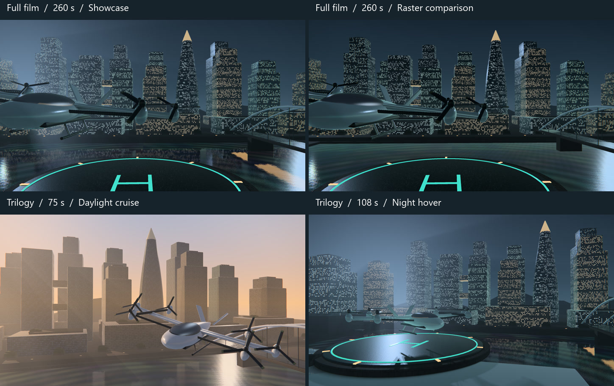

# BOO SAH SAH · Shenzhen aircraft graphics review

November 19, 2026 · Existing Windows Release build · Checkout `5ff4665`

The six-rotor Shenzhen aircraft already reads as a flying machine in the trilogy’s daylight cruise. At **4:20 in the full film**, the frame cuts through its nose and near-side rotor assemblies. Its dark blades cross hundreds of bright office windows. Give the audience a moment to see the whole aircraft, then use the approaching landing pad to turn its rotor wash into something strange. That would give this sequence both the precision of a vehicle showcase and a visual signature of its own.

## Reproduce the shot

From the repository root, run the existing capture tool. It writes the exact frames in the table, at 2560 × 1440, without having to pause playback at precisely the right time.

    .\build\x64-release\boo_integration_tests.exe --validation-captures --no-activate --capture-dir build/aircraft-review-replay

| Cue and time | Family edition capture | What to look at |
| --- | --- | --- |
| Full film · 4:20 | `film360_family_260s.png` | Follow the nose left to the edge. The canopy highlight, two visible right-side hubs and pad are readable, but the frame conceals how the assemblies connect. Switching to raster reproduces the crop. |
| 180-second trilogy · 1:15 | `m2_180_family_75s.png` | The elevated three-quarter view separates the pearl nose, dark canopy and swept rotor arms. The bank makes the direction of travel clear. Use this as the visual reference for the night shot. |
| 180-second trilogy · 1:48 | `m2_180_family_108s.png` | The whole aircraft fits over the pad. Its dark arms overlap the horizontal waterfront façade, while the bright cyan ring draws the eye below the aircraft. Framing alone fixes only part of the night shot. |

The capture run passed all 38 sample/edition checks on an RTX 5080 Laptop GPU. Repeat seeks matched and the HDR buffers had zero nonfinite components. The new 260-second PNG also matched the archived preferred PNG byte for byte. The upper-right image is the archived raster comparison from that same shot. [Fresh capture manifest](../build/aircraft-review-20261119/manifest.json) · [Archived preferred/raster manifest](../build/film_captures/manifest.json)

For the **audience view**, start a few seconds earlier and let the transition play. Press **A** until **Codec** appears. The left half shows the processed picture and the right half shows the clean source. The film automatically engages Signal Hijack in the 245–275 s interval. This run verified a 1280 × 720 hardware H.264 round trip. F12 saves the clean frame, so the contact sheet isolates a framing problem that already exists before compression. It does not measure how much detail compression costs in motion. [Live playback diagnostics](../build/aircraft-review-20261119/film-signal.json) · [Presentation comparison](../assets/shaders/m1_taipei_slice.hlsl#L2529)

    .\build\x64-release\boo_sah_sah.exe --cue assets/cues/film_360s.json --edition family --preset showcase --start-seconds 253 --no-captions --no-activate

## Where to spend the graphics effort

1. **Stage one complete flyby.** Start with the aircraft high enough in frame for the sky to separate the rotor tips. Track the actual moving aircraft through its bank, with a little space ahead of the nose. Save the tight canopy crop for a deliberate second shot. The full-film camera estimates its own aircraft path, while the mesh runs the trilogy’s flight path at double speed. At 260 s the two reference positions differ by approximately 5.7 scene units. That explains why tracking merits the first experiment. It does not quantify a focus error. [Full-film camera](../src/render/m1_scene.cpp#L624) · [Aircraft transform](../src/render/trilogy_renderer.cpp#L296) · [Trilogy camera](../src/render/m1_scene.cpp#L49)
2. **Light the material transitions.** Let a long, warm reflection from the terminal travel from the canopy shoulder across the pearl fuselage as the aircraft banks. Give the outside nacelles a narrow cool highlight. Lower the window brightness immediately behind the rotor arc and let the landing ring brighten as the craft settles. NVIDIA and Epic’s *Speed of Light* is the relevant reference. Its animated studio lights made the Porsche’s curvature readable in motion, and the artists matched material responses to photography. A cinema camera and an interactive lighting view shared the same vehicle. [NVIDIA and Epic on lighting the Speedster](https://developer.nvidia.com/blog/nvidia-epic-games-and-real-time-ray-tracing/)
3. **Spend detail where a close-up can show it.** The aircraft already has a canopy, tilted nacelles and individually turning blades. Its cabin is represented by a simple glowing volume and the wings and blades use thin beveled forms. For the insert, give the canopy a recessed rim and visible interior depth, and give one nacelle a readable hinge, fairing and blade root. Keep carbon satin, hull paint glossy and glass dark enough to retain depth. Change the aircraft’s material assignment locally because some of its material slots also serve other acts. [Aircraft construction](../tools/gen_trilogy_meshes.py#L862) · [Shared material definitions](../tools/gen_pbr_textures.py#L344)

## Three experiments worth trying

| Experiment | What the audience would see | How to keep it robust |
| --- | --- | --- |
| **Iridescent rotor wash** | Six short ribbons begin at the tilted nacelles. As they turn vertical, the ribbons bend downward and spread into interference rings under the aircraft. Bass opens up the spacing between rings. The full-film spray currently stays at a fixed point on the pad, even during approach. | Anchor emission to the moving hubs and gate the surface rings by height. Start with a few clean arcs on the shader fallback. Add density on CUDA. With silent audio, use the flight and hover phases to carry the reveal. [Existing downwash](../assets/shaders/m1_taipei_slice.hlsl#L3741) · [NVIDIA RTX Racer vehicle and dust study](https://developer.nvidia.com/blog/nvidia-omniverse-rtx-racing-demo-showcases-powerful-rendering-realistic-simulation/) |
| **A signal echo in the bay** | The real aircraft clears the terminal. Its reflection stays behind for a beat, splits into colored bands, then catches up as the landing-pad ring closes. Give the effect one deliberate entrance and exit. | Keep the echo in the water or terminal glass. Clear its history on seek, loop or edition switch. Compare hardware codec and shader substitution at the same time. Reduced-flash mode can retain the slow color shift and reduced-motion mode can shorten the trail. [Current codec presentation](../src/render/m1_taipei_slice.cpp#L3789) |
| **Madame N conducts the orchid** | In the NPU solo, hold the orchid in one composition. Let one visible change, such as the opening of an iris or a moving band of color across the petals, follow a single director output. In telemetry view, show that output and the completed-inference count together. | Keep the controls bounded and smoothed. Compare the same cue on hardware and scripted playback, including a seek and the existing NPU-timeout simulation. The full-film aircraft cue explicitly locks director modulation. The solo already permits it. [Director outputs and cue lock](../src/inference/openvino_director.cpp#L907) · [NPU solo cue](../assets/cues/solo_npu.json) |

**A practical review gate.** Start with the camera change alone. During the proposed two-second establishing hold, keep the nose, skids and outer rotor tips inside the frame with roughly 5% breathing room. View the shot at 320 × 180 and ask a fresh viewer to point to the nose and say which way the aircraft is moving. Repeat at night with the skyline lit. Then add the wake and the echo individually. Watch 253–268 s continuously, seek directly to 260 s, and cross the 275 s cut. Look for disconnected wakes, stale echoes, a lost rotor outline and a sudden luminance jump. Compare Showcase and Safe, full and reduced motion/flash, plus sound and silence. The current full-film camera branch omits the motion-scale factor, which makes the reduced-motion pass especially worth checking. [Camera motion scaling](../src/render/m1_scene.cpp#L479)

For performance, the live Showcase run starting at 253 s recorded **11.62 ms p95 GPU time**, 975 rendered frames and zero quality downgrades on this laptop. Repeat the same window and settings for each effect and inspect frame pacing as well as GPU time. This is one machine and one run. The clean-image gate uses deterministic inputs, so music response needs a separate live playback check. [Runtime timing](../build/aircraft-review-20261119/film-signal.json) · [Clean-capture path](../src/render/m1_taipei_slice.cpp#L4473)

## What the NPU claim can support

**“On supported Intel PCs, BOO SAH SAH uses the NPU as a live stage director for its real-time film.”** In two runs of the existing Madame N solo from 12 s with the same Showcase settings, the enabled run selected Intel AI Boost through OpenVINO and completed **51 inferences**. The explicitly disabled run selected the scripted director and completed **0**. The asynchronous director targets five updates per second and supplies bloom, iris, lighting, palette and cut-accent controls. The renderer decides which controls each scene accepts. Hardware availability and successful inference are reported separately. [Enabled run](../build/aircraft-review-20261119/solo-npu-on.json) · [Disabled run](../build/aircraft-review-20261119/solo-npu-off.json) · [Playback integration](../src/app/main.cpp#L2611)

Earlier projects establish that PC graphics demos already used NPUs. James Stringer’s March 2026 *NPU Rubber Duck Bath Simulator* ran wave and duck simulation on Intel AI Boost, shaded the result on the GPU and offered a manual CPU option. Anne Jan Brouwer’s November 7 AMD NPU experiments included demoscene plasma, a rotating tunnel and sphere tracing. I found no documented earlier match for the narrower combination of a Windows demoscene film and an optional neural stage director. Historical priority for that combination remains open. The visible director comparison is a claim viewers can verify for themselves. [Stringer’s project and recording](https://github.com/jamesstringer90/NPU-Demo) · [Brouwer’s dated experiments](https://github.com/annejan/npu-iron-experiments/commit/6c406ab8ece482a19a5b8b102822d8be332d1f66)

## Release criteria for the graphics update

Carry these criteria into the consolidated plan for the aircraft, experimental effects and NPU director.

- **Support all 25 languages.** Translate each new caption, effect control, hardware status and fallback message. The current 25 catalogs share 72 keys and match the language sets in the MSIX descriptions and Store listing copy. All 22 unit tests passed on November 19, including `UiStringCatalogs`. For the new build, rerun the catalog and layout checks, then inspect the installed UI with right-to-left Arabic, both Chinese scripts, Hindi or Thai, and expanded pseudo-localized text. Check startup, captions and the most crowded telemetry screen. [Runtime catalogs](../assets/strings/) · [Localization tests](../tests/unit/unit_main.cpp#L1219) · [Store copy](../packaging/store-listing.md)
- **Build a fresh x64 MSIX from the reviewed release.** The local `1.0.0.0` archive contains all 25 catalogs, but its executable’s SHA-256 differs from the current Release executable. Restage the finished build, match the existing Partner Center product identity and choose a version above the one customers have. Verify the executable hash, compiled shaders, changed assets, language list, resource index and NPU runtime inside the resulting archive. [Release staging](../scripts/package_release.ps1) · [MSIX builder](../packaging/msix/make-msix.ps1) · [Microsoft’s update checklist](https://learn.microsoft.com/en-us/windows/apps/publish/store-readiness-checklist)
- **Exercise the customer’s install and update paths.** On a test system, run a clean install and an in-place upgrade from the previous release using a signed candidate or Store flight. Launch from Start and check the aircraft shot, experimental controls, audio, localized HUD and F12 capture. Run Madame N with the packaged libraries on a supported NPU and verify scripted playback with the NPU disabled. Save the package hash, test results and screenshots with the release handoff, and refresh affected localized listing copy and certification notes for Partner Center. [Packaging guide](PACKAGING.md) · [Store submission notes](../packaging/store-certification.md)
